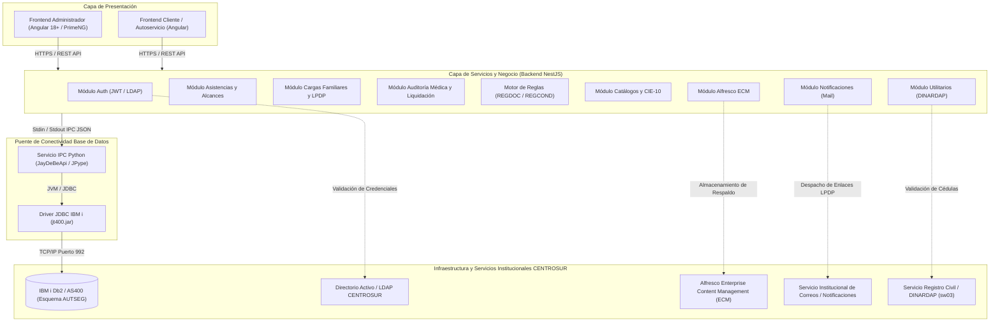
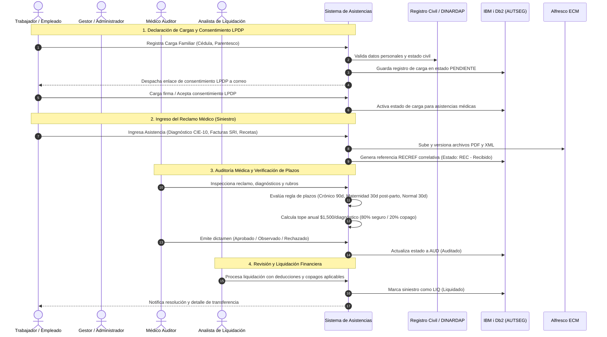
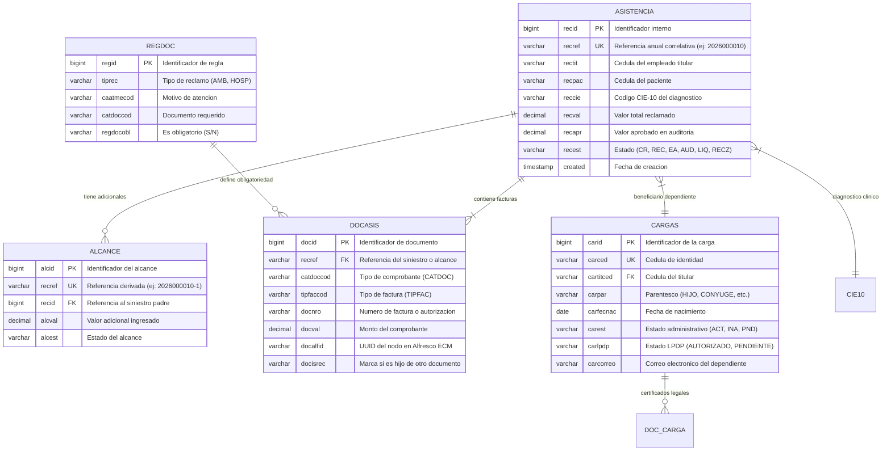
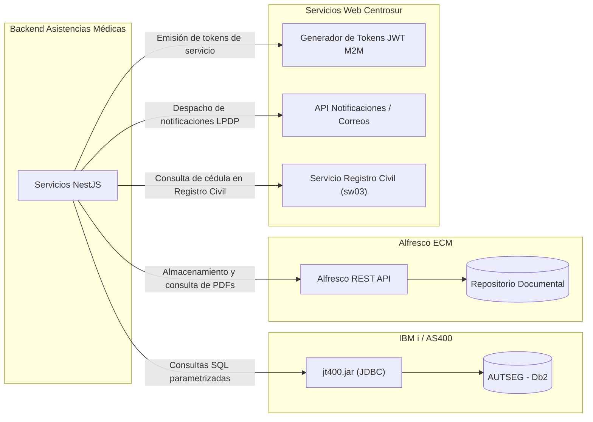

# Documentación Técnica y Arquitectura del Sistema de Asistencias Médicas

---

## 1. Identificación y Propósito del Sistema

El **Sistema de Gestión de Asistencias Médicas y Cargas Familiares** es una plataforma corporativa desarrollada para la **Empresa Eléctrica Regional Centro Sur C.A. (CENTROSUR)**. 

El objetivo primordial del sistema es digitalizar, automatizar y auditar de forma integral el ciclo de vida de los reclamos de reembolsos de gastos médicos presentados por los trabajadores y sus dependientes (cargas familiares), garantizando el cumplimiento de la normativa institucional de autoseguro médico, las políticas de protección de datos (LPDP) y la integración con la infraestructura corporativa (IBM i / AS400, Alfresco ECM, Registro Civil / DINARDAP, y Notificaciones Institucionales).

---

## 2. Arquitectura General y Topología

El sistema está construido bajo un patrón desacoplado en capas, integrando componentes web modernos con sistemas legados institucionales mediante puentes de comunicación de alto rendimiento.



---

## 3. Flujo del Proceso de Negocio de Asistencias Médicas

El ciclo de atención médica comprende desde la solicitud inicial del titular hasta el dictamen médico y la posterior orden de liquidación financiera.



---

## 4. Estructura del Proyecto

El repositorio está estructurado como un monorepositorio con separación limpia entre la lógica de servidor y las aplicaciones cliente.

```text
asistencias-medicas/
├── backend/                              # Servidor de aplicaciones NestJS
│   ├── src/
│   │   ├── alfresco/                     # Cliente de integración con repositorio documental Alfresco
│   │   ├── asistencias/                  # Gestión de siniestros médicos, alcances y plazos
│   │   ├── auth/                         # Autenticación, JWT, roles y validación de usuarios
│   │   ├── cargas/                       # Maestro de cargas familiares y validación LPDP
│   │   ├── catalogos/                    # Controladores de catálogos institucionales
│   │   ├── cie10/                        # Clasificación Internacional de Enfermedades CIE-10
│   │   ├── database/                     # Adaptador DB2 y puente Python con soporte CLOB/BLOB
│   │   ├── empleados/                    # Integración con nómina y directorio activo Centrosur
│   │   ├── notificaciones/               # Notificaciones automáticas por correo electrónico
│   │   ├── parametros/                   # Parámetros dinámicos desde BD2 / .env
│   │   ├── reglamento/                   # Motor dinámico de reglas (REGDOC y REGCOND)
│   │   └── utils/                        # Conexión con Registro Civil DINARDAP (sw03)
│   ├── test/                             # Pruebas e2e y unitarias
│   ├── jt400.jar                         # Driver JDBC oficial IBM i JTOpen
│   └── nest-cli.json                     # Configuración de compilación y copiado de assets
│
├── frontend-administrador/               # Portal Web de Administración y Auditoría (Angular 18+)
│   ├── src/
│   │   ├── app/
│   │   │   ├── core/                     # Modelos de dominio, servicios base, interceptores
│   │   │   └── features/                 # Módulos funcionales por rol de usuario
│   │   │       ├── alcances/             # Historial y registro de alcances a siniestros aprobados
│   │   │       ├── asistencias/          # Bandeja general de reclamos y wizard de creación
│   │   │       ├── autorizacion-lpdp/    # Formulario público de consentimiento de datos
│   │   │       ├── cargas/               # Gestión de cargas por titular
│   │   │       ├── catalogos/            # Mantenimiento de tablas maestras
│   │   │       ├── dev/reglamento/       # Consola de reglas de negocio documentales
│   │   │       ├── home/                 # Tablero de control y estadísticas operativas
│   │   │       ├── login/                # Autenticación institucional
│   │   │       ├── medico-auditor/       # Módulo especializado de auditoría médica
│   │   │       ├── revision-liquidacion/ # Módulo de liquidación financiera de reembolsos
│   │   │       ├── revision-reclamos/    # Mesa de partes y validación documental
│   │   │       ├── validacion-cargas/    # Aprobación de cargas registradas
│   │   │       └── validacion-lpdp/      # Control de consentimientos de datos personales
│   │   └── styles.scss                   # Variables y estilos globales de diseño
│   └── angular.json                      # Configuración de Angular CLI y compilación de producción
│
├── frontend-cliente/                     # Portal Web Autoservicio para Empleados (Angular)
│   └── src/app/pages/                    # Vistas para ingreso de reclamos, dependientes y seguimiento
│
├── BD_AVISOS_CONSUMIBLES.sql             # Script SQL de inicialización de avisos y parámetros
├── README.md                             # Documento base
└── README_VISUALIZATION.md               # Esta especificación técnica y arquitectónica
```

---

## 5. Descripción de Módulos Principales

### 5.1 Backend (NestJS)

| Módulo | Ruta Base | Funcionalidad Central |
| :--- | :--- | :--- |
| `AuthModule` | `/api/auth` | Login institucional LDAP Centrosur, emisión de tokens JWT, control de accesos basado en roles (RBAC). |
| `AsistenciasModule` | `/api/asistencias` | CRUD de siniestros, asignación de identificador correlativo anual (`2026XXXXXX`), control de facturación duplicada por clave de acceso SRI, gestión de alcances (`recref-N`). |
| `CargasModule` | `/api/cargas` | Registro de dependientes familiares, evaluación de elegibilidad (edad, parentesco, discapacidad), emisión de enlace seguro de autorización LPDP con token efímero y cron mensual para cargas que cumplen 18 años. |
| `MedicoAuditorModule` | `/api/asistencias/auditoria` | Desglose por línea de factura médica (honorarios, medicinas, laboratorio, suministros), aplicación del copago (80% seguro / 20% afiliado) y control de techo anual de $1,500 por diagnóstico CIE-10. |
| `DatabaseModule` | Interno | Servicio singleton que administra el subproceso Python (`db_service.py`), comunicándose vía JSON sobre Stdin/Stdout para ejecutar consultas parametrizadas en DB2 AS400, convirtiendo tipos `CLOB`, `BLOB`, `Date` y `Timestamp`. |
| `UtilsModule` | `/api/utils` | Consulta de ciudadanos en Registro Civil / DINARDAP mediante servicio institucional `sw03`, normalizando nombres, sexo, estado civil y parentescos legales. |
| `AlfrescoModule` | `/api/alfresco` | Gestión de expedientes electrónicos en Alfresco ECM: subida multipart, asignación de metadatos de reclamo, descarga y streaming de comprobantes en visor seguro. |

### 5.2 Frontend Administrador (Angular 18+)

| Módulo / Vista | Ruta Web | Descripción y Rol de Usuario |
| :--- | :--- | :--- |
| **Bandeja de Asistencias** | `/asistencias` | Gestión integral de asistencias. Incluye wizard de creación en representación de afiliados, visor de documentos integrado y carga automática de datos desde XML de facturación electrónica del SRI. |
| **Alcances Complementarios** | `/alcances` | Permite gestionar gastos médicos adicionales ocurridos con posterioridad a un siniestro aprobado, asociando facturas hijas y recalculando montos sin alterar el expediente original. |
| **Auditoría Médica** | `/medico-auditor` | Espacio de trabajo exclusivo para los médicos auditores. Permite aprobar o glosar rubros, validar plazos según tipo de afección y monitorear la bolsa anual acumulada por diagnóstico. |
| **Revisión y Liquidación** | `/revision-liquidacion` | Emisión de la liquidación económica del autoseguro, cálculo del valor neto a transferir y generación de reportes consolidados. |
| **Validación de Cargas** | `/validacion-cargas` | Panel de inspección para trabajo social y talento humano para verificar certificados de nacimiento, matrimonio y discapacidad antes de habilitar asistencias. |
| **Cumplimiento LPDP** | `/validacion-lpdp` | Monitoreo en tiempo real del estado de consentimiento de tratamiento de datos personales de dependientes mayores de edad. |
| **Motor de Reglamento** | `/dev/reglamento` | Administrador visual de las matrices normativas `REGDOC` (documentos exigidos por tipo de factura) y `REGCOND` (condiciones y reglas por parentesco). |

---

## 6. Reglas de Negocio Clave

### 6.1 Límites de Cobertura y Copago
- **Tope Anual**: Hasta \$1,500 USD por cada diagnóstico (CIE-10) al año por titular/beneficiario.
- **Distribución Financiera**: 
  - **80%** cubierto por el fondo de autoseguro médico de Centrosur.
  - **20%** copago asumido por el afiliado o deducible de su liquidación.

### 6.2 Plazos de Presentación y Acumulación de Gastos
La plataforma evalúa dinámicamente los plazos normativos a partir de la fecha de emisión de cada comprobante de gasto:

| Tipo de Afección | Regla de Acumulación y Plazo | Identificador Aviso |
| :--- | :--- | :--- |
| **Enfermedad Crónica** | Plazo permitido: Hasta **90 días** contados a partir de la fecha de emisión de cada factura. | `PLZ_CRON` |
| **Maternidad / Embarazo** | Acumulación permitida durante todo el periodo de gestación hasta el parto. Plazo máximo de entrega: **30 días** contados a partir de la fecha de nacimiento del recién nacido. | `PLZ_EMB` |
| **Reclamos Normales** | Plazo permitido: Máximo **30 días** contados a partir de la fecha de emisión de la factura. | `PLZ_NORM` |

### 6.3 Ciclo de Vida del Consentimiento LPDP (Ley de Protección de Datos Personales)
- Los dependientes menores de 18 años son representados legalmente por el titular.
- Los dependientes que cumplan la mayoría de edad (18 años) requieren otorgar su propio consentimiento informado.
- El sistema cuenta con un proceso automatizado que detecta a los dependientes próximos a cumplir la mayoría de edad y genera un token criptográfico seguro que se envía a su correo personal para registrar la firma digital.

---

## 7. Modelo de Datos Central (IBM i Db2 - Esquema AUTSEG)



---

## 8. Integraciones Institucionales



1. **IBM i Db2 (`AUTSEG`)**: Motor transaccional principal con soporte para datos relacionales y almacenamiento CLOB/BLOB mediante el conector Java/Python.
2. **Alfresco ECM**: Custodia y archivo electrónico de facturas XML, representaciones RIDE en PDF, recetas médicas e informes clínicos.
3. **Registro Civil / DINARDAP (`sw03`)**: Servicio REST en `https://portal.centrosur.gob.ec/tthh/rest/sw03` consumido con cabecera de autenticación y carga útil estricta `{ "cedula": "..." }`.
4. **Notificaciones Centrosur**: Despacho automático de notificaciones de estado y enlaces de consentimiento con plantillas HTML corporativas.

---

## 9. Guía de Ejecución y Despliegue Local

### 9.1 Requisitos Previos
- **Node.js**: Versión 18.x o superior.
- **Python**: Versión 3.9 o superior con módulos `jaydebeapi` y `jpype1`.
- **Java Runtime Environment (JRE)**: Versión 8 u 11 (variable `JAVA_HOME` configurada).
- **Angular CLI**: Versión 18.x (`npm install -g @angular/cli`).

### 9.2 Configuración del Backend
1. Navegar al directorio del backend:
   ```bash
   cd backend
   ```
2. Instalar dependencias:
   ```bash
   npm install
   ```
3. Configurar variables de entorno en el archivo `.env`:
   ```env
   PORT=3000
   NODE_ENV=development

   # Base de Datos IBM i Db2
   DB2_HOST=172.19.128.59
   DB2_USER=APPNEST
   DB2_PASSWORD=AP20NEST26
   DB2_SCHEMA=AUTSEG
   DB_DRIVER=jdbc_python

   # Seguridad
   JWT_SECRET=supersecretkeyshouldbeverylongandrandomfortokengeneration
   ENCRYPTION_KEY=miclavedecifradosimetricoaes256

   # Repositorio Documental Alfresco
   ALFRESCO_BASE_URL=https://nest.centrosur.gob.ec/alfresco/api
   ALFRESCO_ROOT_NODE_ID=6273400f-202a-486d-86d1-exxxxxxxxxxxx
   ALFRESCO_JWT_TOKEN=eyJhbGciOiJIUzI1NiIsInR5cCI6IkpXVCJ9...

   # Notificaciones Centrosur
   CENTROSUR_NOTIFICATIONS_URL=https://nest1.centrosur.gob.ec/notifications/api/send-mail-generico
   ```
4. Compilar y ejecutar:
   ```bash
   npm run build
   npm run start:dev
   ```

### 9.3 Configuración del Frontend Administrador
1. Navegar al directorio del frontend administrador:
   ```bash
   cd frontend-administrador
   ```
2. Instalar dependencias:
   ```bash
   npm install
   ```
3. Compilar o ejecutar en modo desarrollo:
   ```bash
   # Modo desarrollo (puerto 4200)
   npm start

   # Compilación de producción
   npm run build
   ```

---

## 10. Enlaces Directos a Archivos Clave del Repositorio

- **Conector y Adaptador DB2**: [backend/src/database/db_service.py](file:///c:/Users/juand/OneDrive/Documentos/asistencias-medicas/backend/src/database/db_service.py)
- **Servicio de Utilitarios y Registro Civil**: [backend/src/utils/utils.service.ts](file:///c:/Users/juand/OneDrive/Documentos/asistencias-medicas/backend/src/utils/utils.service.ts)
- **Gestión de Asistencias y Facturas**: [backend/src/asistencias/asistencias.service.ts](file:///c:/Users/juand/OneDrive/Documentos/asistencias-medicas/backend/src/asistencias/asistencias.service.ts)
- **Gestión y Ciclo de Vida LPDP**: [backend/src/cargas/cargas.service.ts](file:///c:/Users/juand/OneDrive/Documentos/asistencias-medicas/backend/src/cargas/cargas.service.ts)
- **Componente de Alcances Médicos**: [frontend-administrador/src/app/features/alcances/alcances.component.ts](file:///c:/Users/juand/OneDrive/Documentos/asistencias-medicas/frontend-administrador/src/app/features/alcances/alcances.component.ts)
- **Auditoría Médica**: [frontend-administrador/src/app/features/medico-auditor/medico-auditor.component.ts](file:///c:/Users/juand/OneDrive/Documentos/asistencias-medicas/frontend-administrador/src/app/features/medico-auditor/medico-auditor.component.ts)
- **Script SQL de Avisos y Plazos Normativos**: [BD_AVISOS_CONSUMIBLES.sql](file:///c:/Users/juand/OneDrive/Documentos/asistencias-medicas/BD_AVISOS_CONSUMIBLES.sql)
